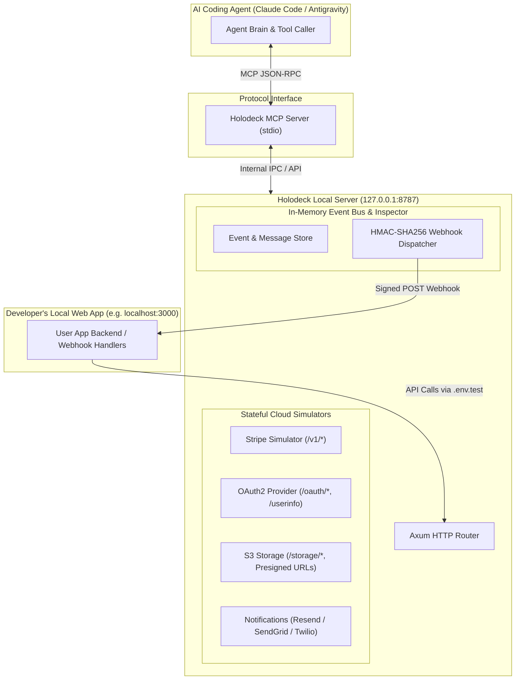

# Product Requirements Document (PRD)

## Project Name: `Holodeck` (MCP)
**Sub-title:** The Universal Local Mock-Cloud, SaaS & Webhook Simulator for AI Coding Agents  
**Target Clients:** Claude Code, Antigravity, Cursor, Windsurf, Aider (via Model Context Protocol)  
**Language & Stack:** Rust (Tokio, Axum, Tower, HMAC-SHA256, serde)  
**License:** Apache 2.0 / MIT  
**Status:** Approved for Implementation  

---

## 1. Executive Summary

### 1.1 Problem Statement
When developers instruct AI coding agents (Claude Code, Antigravity, Cursor) to implement features involving external cloud APIs (Stripe, OAuth2, AWS S3, Resend, Twilio):
1. **The Sandbox Dead-End:** Agents cannot test integrations because developers cannot safely give them production API keys, and setting up staging/sandbox accounts requires manual dashboard work.
2. **The Webhook Verification Gap:** Modern webhooks require signed HMAC-SHA256 headers (e.g., Stripe, GitHub) and reachable endpoints. Agents cannot trigger or verify their own webhook handlers locally without manual `curl` commands and fake headers.
3. **Integration Test Amnesia:** Agents write mock-heavy unit tests that mock away the entire external library, meaning tests pass locally while completely failing in production due to subtle API payload mismatches.

### 1.2 Vision & Value Proposition
`Holodeck` is an ultra-fast, local-first mock-cloud runtime and MCP server written in Rust. It runs entirely on `localhost:8787` with zero configuration, simulating the top cloud services with stateful behavior, realistic API responses, and automated webhook generation.

It enables agents to:
* **Trigger Signed Webhooks Autonomously:** Dispatch real, timestamped, HMAC-SHA256 signed Stripe and GitHub webhooks to their local dev server (`http://localhost:3000/api/webhooks/stripe`).
* **Inspect Outgoing Side-Effects:** Verify that emails, SMS messages, and charges were actually sent by inspecting the Holodeck event log via MCP.
* **Test End-to-End User Journeys:** Run OAuth2 login, file uploads, and subscription checkouts with zero real API keys.

---

## 2. System Architecture

---

## 3. Supported Providers (v1.0)

### 3.1 Stripe Simulator
* **Endpoints:**
  * `POST /v1/customers`: Creates and persists simulated customer.
  * `POST /v1/checkout/sessions`: Creates session with realistic `cs_test_...` ID and checkout URL.
  * `POST /v1/payment_intents`: Generates `pi_test_...` with automatic confirmation.
  * `POST /v1/subscriptions`: Manages customer subscription status (`active`, `past_due`, `canceled`).
* **Webhook Signature Format:**
  * Computes exact timestamped HMAC-SHA256 signature matching Stripe format:
    `t=<timestamp>,v1=<hex_signature>` using secret `whsec_test_holodeck_secret_key`.

### 3.2 OAuth2 Mock Provider
* **Endpoints:**
  * `GET /oauth/authorize`: Automatically redirects to `redirect_uri` with valid authorization `code` and preserved `state`.
  * `POST /oauth/token`: Exchanges code for mock JWT bearer token.
  * `GET /userinfo` & `GET /user`: Returns realistic profile JSON for simulated Google or GitHub accounts.

### 3.3 S3 / Blob Storage
* **Endpoints:**
  * `PUT /storage/:bucket/:key`: Stores uploaded file bytes in memory/temp directory.
  * `GET /storage/:bucket/:key`: Serves stored file with proper headers.
  * `POST /storage/presign`: Generates realistic presigned URLs with 15-minute expiration.

### 3.4 Email & SMS Sandbox
* **Endpoints:**
  * `POST /v1/emails` (Resend format)
  * `POST /v3/mail/send` (SendGrid format)
  * `POST /2010-04-01/Accounts/:AccountSid/Messages.json` (Twilio SMS format)
* **Behavior:** Captures all outgoing messages in Holodeck's event log without sending external traffic.

---

## 4. MCP Tools Exposed to AI Agents

1. **`holodeck_trigger_webhook`**
   * **Params:** `provider: "stripe" | "github"`, `event: string`, `target_url: string`, `custom_payload?: object`
   * **Description:** Dispatches a cryptographic HMAC-SHA256 signed webhook payload to the agent's local development server.
2. **`holodeck_inspect_events`**
   * **Params:** `provider?: string`, `limit?: number`
   * **Description:** Queries captured emails, SMS messages, charges, and webhook attempts to verify backend side-effects during automated tests.
3. **`holodeck_get_mock_credentials`**
   * **Params:** `provider: string`
   * **Description:** Returns dummy API keys, base URLs, and webhook secrets for pasting into `.env.test` or local configuration.
4. **`holodeck_reset_state`**
   * **Params:** `provider?: string`
   * **Description:** Clears all mock database records and event logs between test runs.

---

## 5. Security & Zero-Egress Invariants

* **100% Local-First:** Bound strictly to `127.0.0.1`. No outbound network calls are ever made to third-party clouds.
* **Deterministic Test Keys:** Uses predictable test prefixes (`sk_test_holodeck_...`, `whsec_test_...`) to guarantee safety.
