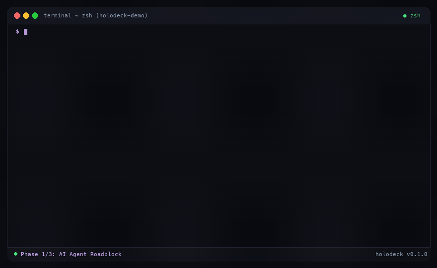

# 🌌 HOLODECK
```text
  _    _  ____  _      ____  _____  ______ _____ _  __
 | |  | |/ __ \| |    / __ \|  __ \|  ____/ ____| |/ /
 | |__| | |  | | |   | |  | | |  | | |__ | |    | ' / 
 |  __  | |  | | |   | |  | | |  | |  __|| |    |  <  
 | |  | | |__| | |___| |__| | |__| | |___| |____| . \ 
 |_|  |_|\____/|______\____/|_____/|______\_____|_|\_\
```
> **The Universal Local Mock-Cloud, SaaS & Webhook Simulator for AI Coding Agents**  
> *Zero Credentials. Cryptographic Webhook Signatures. Complete Local Autonomy.*

[](https://github.com/khalidfarooq/holodeck/actions/workflows/ci.yml)
[](#)
[-purple.svg)](#)
[](#)
[](#)

<p align="center">
  
</p>

---

## ⚡ The Problem: Why Autonomous Coding Agents Get Stuck

When you prompt **Claude Code, Google Antigravity, or Cursor** to build a feature involving external cloud APIs (billing, auth, uploads, emails), it almost always fails or writes fake mocks:

| The Agent Bottleneck | With Holodeck Simulation |
| :--- | :--- |
| **No API Keys:** Giving an agent live Stripe, AWS, or Resend credentials is dangerous and costly. | **Zero-Config In-Memory Mocks:** Full mock endpoints for Stripe, OAuth2, S3, and Resend out of the box. |
| **Dead Webhooks:** Agents cannot test Stripe/GitHub webhooks without public URLs or manual ngrok tunnels. | **Cryptographic Injector:** Agents trigger real, timestamped, HMAC-SHA256 signed webhooks directly to `localhost`. |
| **Silent Mock Passes:** Agents write brittle unit test mocks that hide runtime bugs and broken schemas. | **True E2E Verification:** The agent calls the mock cloud, inspects side-effects via MCP, and fixes real bugs. |

---

## 🏗️ Architecture

```mermaid
flowchart LR
    subgraph Agent["🤖 Autonomous AI Agent (Claude Code / Antigravity / Cursor)"]
        LLM["Agent Reasoning Engine"]
    end

    subgraph Holodeck["🌌 Holodeck Runtime (127.0.0.1:8787)"]
        direction TB
        MCP["MCP JSON-RPC Server (stdio)"]
        ROUTER["Axum Local Cloud Router"]

        subgraph Providers["Stateful Cloud Services"]
            STRIPE["💳 Stripe Simulator<br/>(Customers, Checkouts, Invoices)"]
            OAUTH["🔑 OAuth2 / OIDC Provider<br/>(Google, GitHub Redirects & Tokens)"]
            S3["🪣 S3 Storage<br/>(Presigned URLs, Buckets, Payloads)"]
            NOTIF["📨 Notification Sandbox<br/>(Resend, SendGrid, Twilio)"]
        end

        subgraph EventBus["Verification Engine"]
            HMAC["🔐 HMAC-SHA256 Cryptographic Signer"]
            LOG["📜 Queryable Event Log"]
        end
    end

    subgraph App["💻 Your Local App Under Test (localhost:3000)"]
        BACKEND["Local Server Endpoints & Webhook Handlers"]
    end

    LLM <-->|MCP Tools (stdio)| MCP
    MCP <--> ROUTER
    ROUTER --> Providers
    Providers --> LOG
    HMAC -->|HMAC Signed Webhook POST| BACKEND
    BACKEND -->|Mock Cloud API Calls (.env.test)| ROUTER
```

---

## 🛠️ Supported Cloud Simulators

### 1. 💳 Stripe Simulation
* **Endpoints:** `POST /v1/customers`, `POST /v1/checkout/sessions`, `POST /v1/checkout/sessions/:id/complete`, `POST /v1/payment_intents`, `POST /v1/subscriptions`
* **Real Webhooks:** Dispatches realistic JSON payloads with authentic timestamped HMAC-SHA256 signatures (`t=...,v1=...`) matching Stripe's exact cryptographic protocol.

### 2. 🔑 OAuth2 / OIDC Provider
* **Endpoints:** `GET /oauth/authorize`, `POST /oauth/token`, `GET /userinfo`, `GET /user`
* **Zero Redirect Latency:** Auto-redirects back to your app callback URL with valid authorization codes and mock JWT tokens for Google and GitHub accounts. Supports both `application/x-www-form-urlencoded` and `application/json`.

### 3. 🪣 S3 / Blob Storage
* **Endpoints:** `POST /storage/presign`, `PUT /storage/:bucket/*key`, `GET /storage/:bucket/*key`, `DELETE /storage/:bucket/*key`
* **Features:** Realistic presigned PUT/GET URLs, raw byte storage, and queryable metadata.

### 4. 📨 Notification Sandbox (Resend / SendGrid / Twilio)
* **Endpoints:** `POST /v1/emails` (Resend), `POST /v3/mail/send` (SendGrid), `POST /2010-04-01/Accounts/:AccountSid/Messages.json` (Twilio)
* **Features:** Catches all outbound emails and SMS in an inspectable in-memory sandbox.

---

## 🤖 Model Context Protocol (MCP) Tools

When Holodeck runs in MCP mode (`holodeck mcp`), AI coding agents can call these tools natively over stdio:

| MCP Tool | Description |
| :--- | :--- |
| `holodeck_trigger_webhook` | Dispatches an HMAC-SHA256 signed webhook payload to your local dev server (e.g. Stripe, GitHub). |
| `holodeck_inspect_events` | Queries captured emails, SMS, charges, and webhooks to verify backend side-effects during agent test runs. |
| `holodeck_get_mock_credentials` | Returns mock API keys, endpoints, and `.env.test` configuration snippets for any cloud provider. |
| `holodeck_reset_state` | Clears captured event logs and in-memory mock databases between test runs. |

### Connecting to Claude Code / Antigravity / Cursor

Add to your `claude_desktop_config.json` or `.gemini/antigravity/mcp.json` or `.cursor/mcp.json`:

```json
{
  "mcpServers": {
    "holodeck": {
      "command": "holodeck",
      "args": ["mcp"]
    }
  }
}
```

---

## 🚀 CLI Commands

Holodeck ships as a single, high-performance binary:

```bash
# 1. Start the HTTP mock-cloud daemon
holodeck start --port 8787

# 2. Start MCP server over stdio for Claude Code / Antigravity
holodeck mcp

# 3. Dispatch an HMAC signed webhook directly to your local endpoint
holodeck trigger \
  --provider stripe \
  --target http://localhost:3000/api/webhooks/stripe \
  --event checkout.session.completed

# 4. Check daemon status
holodeck status --port 8787

# 5. Output mock credentials to copy into .env.test
holodeck env --provider all
```

---

## 📁 Examples

Check out the included zero-dependency integration examples:
- [Python Agent Example](examples/python/agent_stripe_test.py) (`python3 examples/python/agent_stripe_test.py`)
- [Node.js Agent Example](examples/node/agent_storage_test.js) (`node examples/node/agent_storage_test.js`)

---

## 🏗️ Workspace Structure

```text
holodeck/
├── crates/
│   ├── holodeck-core/     # EventBus, HMAC cryptographic signers, dispatcher, credentials
│   ├── holodeck-stripe/   # Stateful Stripe simulator (customers, checkouts, intents)
│   ├── holodeck-oauth/    # Zero-config OAuth2 / OIDC code grant and profile simulator
│   ├── holodeck-storage/  # S3-compatible bucket storage & presigned URL engine
│   ├── holodeck-notif/    # Resend, SendGrid & Twilio sandbox notification simulator
│   ├── holodeck-server/   # Unified Axum HTTP router with health and event endpoints
│   ├── holodeck-mcp/      # Model Context Protocol stdio JSON-RPC server & tools
│   └── holodeck-cli/      # Unified high-performance CLI binary
├── examples/              # Python and Node.js agent integration scripts
├── .github/workflows/     # Cross-platform GitHub Actions CI pipeline
├── PRD.md                 # Product Requirement Document & Technical Specification
└── README.md
```

---

## 📜 License

Licensed under the MIT License. Developed by Khalid Farooq.
