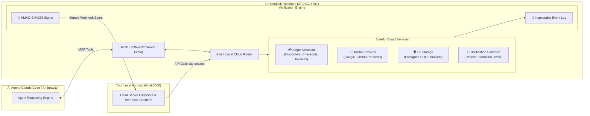

# 🌌 HOLODECK
```text
  _    _  ____  _      ____  _____  ______ _____ _  __
 | |  | |/ __ \| |    / __ \|  __ \|  ____/ ____| |/ /
 | |__| | |  | | |   | |  | | |  | | |__ | |    | ' / 
 |  __  | |  | | |   | |  | | |  | |  __|| |    |  <  
 | |  | | |__| | |___| |__| | |__| | |___| |____| . \ 
 |_|  |_|\____/|______\____/|_____/|______\_____|_|\_\
```
> **The Universal Local Mock-Cloud, SaaS & Webhook Simulator for AI Coding Agents**  
> *Zero Credentials. Real Webhook Signatures. Complete Local Autonomy.*

[](#)
[-purple.svg)](#)
[](#)
[](#)

---

## ⚡ Why Holodeck?

When you ask **Claude Code, Google Antigravity, or Cursor** to build a feature involving external cloud APIs, it almost always fails on the first 5 attempts. Why?

| The Pain Today | With Holodeck Simulation |
| :--- | :--- |
| **No API Keys:** You cannot safely give an agent live Stripe or AWS credentials. | **Zero-Config Mocks:** Pre-configured mock endpoints for Stripe, OAuth, S3, and Resend. |
| **Dead Webhooks:** Agents cannot test Stripe/GitHub webhooks without public URLs and ngrok. | **Cryptographic Dispatcher:** Agents trigger real, timestamped, HMAC-SHA256 signed webhooks to `localhost`. |
| **Silent Mock Passes:** Agents write brittle unit tests that mock out everything, hiding real bugs. | **End-to-End Verification:** The agent calls the mock API, inspects the generated events, and fixes real bugs autonomously. |

---

## 🏗️ Architecture



---

## 🛠️ Supported Cloud Simulators

### 1. 💳 Stripe Simulation
* **Endpoints:** `/v1/customers`, `/v1/checkout/sessions`, `/v1/payment_intents`, `/v1/subscriptions`
* **Real Webhooks:** Dispatches realistic JSON payloads with authentic timestamped HMAC-SHA256 signatures (`t=...,v1=...`) matching Stripe's exact protocol.

### 2. 🔑 OAuth2 Mock Provider
* **Endpoints:** `/oauth/authorize`, `/oauth/token`, `/userinfo`, `/user`
* **Zero Redirect Latency:** Auto-redirects back to your agent's callback URL with valid authorization codes and mock JWT tokens for Google and GitHub accounts.

### 3. 🪣 S3 / Blob Storage
* **Endpoints:** `/storage/:bucket/:key`, `/storage/presign`
* **Features:** Realistic presigned URLs, file byte storage, and bucket policy simulation.

### 4. 📨 Notification Sandbox (Resend / SendGrid / Twilio)
* **Endpoints:** `/v1/emails`, `/v3/mail/send`, `/2010-04-01/Accounts/:AccountSid/Messages.json`
* **Features:** Catches all outbound emails and SMS in an inspectable in-memory inbox.

---

## 🚀 Quickstart

```bash
# 1. Clone & Build
git clone https://github.com/khalidfarooq/holodeck.git
cd holodeck
cargo build --release

# 2. Run the Holodeck Server & MCP Engine
./target/release/holodeck start
```

### Connect to Claude Code / Antigravity via MCP
Add to your `claude_desktop_config.json` or `.gemini/antigravity/mcp.json`:
```json
{
  "mcpServers": {
    "holodeck": {
      "command": "holodeck",
      "args": ["mcp"]
    }
  }
}
```

---

## 📜 License
Apache 2.0 / MIT © [Khalid Farooq](https://github.com/khalidfarooq)
EOF
